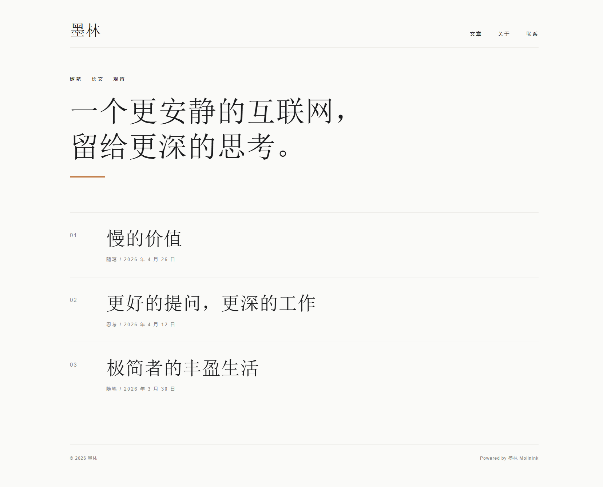
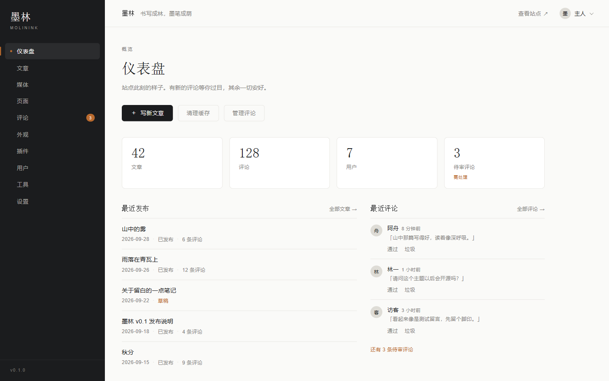
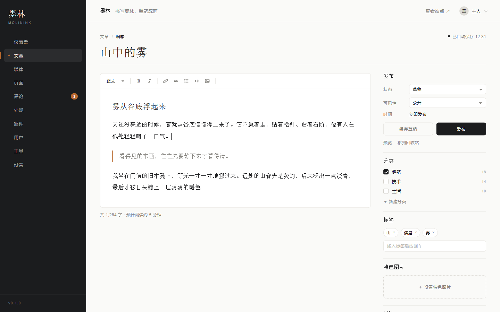

<p align="center"></p>

<p align="center">一个极轻内核的博客程序。内核只做结构，功能和长相都交给插件与主题。</p>

<p align="center"><sub>PHP 8.2+ · MySQL 8 · 单入口 · 装完就能发文</sub></p>

<p align="center"><a href="https://github.com/Hanxui/molinink/releases/latest"><strong>下载安装包</strong></a> · <a href="https://www.molinink.com">官网</a> · <a href="https://demo.molinink.com">演示站</a></p>

<p align="center"></p>

> **先看这条：包从哪下。** 用 [Releases](https://github.com/Hanxui/molinink/releases/latest) 里的 `molin-x.y.z.zip` —— 它自带 `vendor/`，解压到站点根就能装。
>
> 仓库页的 **Code → Download ZIP** 下的是**源码包**：仓库不提交 `vendor/`（依赖由 Composer 管），直接打开会报
> `require(.../vendor/autoload.php): Failed to open stream`，而且还会多套一层 `molinink-main/` 目录。非要用源码包，就在站点根先跑一次 `composer install --no-dev`，再按下面的步骤走。

## 装起来

以宝塔面板为例，十分钟左右。想先看看装好是什么样：<https://demo.molinink.com>

**需要**：PHP 8.2+（`pdo_mysql`、`mbstring`、`json`、`openssl`、`fileinfo`；建议 `gd`、`zip`、`intl`）、MySQL 8 或 MariaDB 10.5+、一个已解析到服务器的域名。

**1. 建站点和数据库**
宝塔 → 网站 → 添加站点：填域名，PHP 版本选 **8.2 或更高**，数据库选 MySQL。记下它给的**库名 / 用户名 / 密码**，第 3 步要用。

**2. 上传并解压**
网站 → 点站点名 → 文件 → 进入站点根目录（一般 `/www/wwwroot/你的域名`）→ 上传 Releases 里的 `molin-<版本>.zip` → 右键解压到当前目录。
根目录下要**直接**看到 `index.php`、`core/`、`install/`。如果多出一层 `molin-x.y.z/` 文件夹，进去全选、剪切到根目录。
**别改用面板的「运行目录」指到那层子目录** —— `/uploads/` 别名、`/storage/` 拦截这些规则都是按站点根写的，指偏了会跟着失效。

**3. 粘两段配置**

伪静态（网站 → 设置 → **伪静态**）——让 `/admin` 和文章页能打开。程序只有一个入口，磁盘上没有 `/admin` 这个文件，得让 nginx 把找不到的地址交给 `index.php`：

```nginx
location / {
    try_files $uri $uri/ /index.php$is_args$args;
}

# 后台是程序路由：admin/ 目录里只有静态资源（css/js/模板），没有 index 文件。
# 少了这两行，nginx 会把它当目录索引，点「进入后台」直接 403 Forbidden。
location = /admin {
    try_files $uri /index.php$is_args$args;
}
location = /admin/ {
    return 301 /admin;
}
```

不加这段的表现：首页正常，但 `/admin` 和所有文章页 404。**如果只加了第一段、漏掉 `/admin` 那两行**，则是另一种症状：文章页正常，登录后台时 `403 Forbidden`（因为根目录下真有一个 `admin/` 目录，nginx 把它当目录索引了）。

挡住 `storage/`（网站 → 设置 → **配置文件**，粘进 `server { }` 里）——里面是备份包、日志、远端备份凭据，不拦就能被直接下载：

```nginx
location ^~ /storage/ {
    return 404;
}
```

图片不用配，程序自己会发（`/uploads/`、`/themes/` 两段是可选的提速项，见 `install/服务器配置.txt`）。

**4. 走向导**
浏览器打开你的域名 → 点「开始安装」：环境自检 → 填第 1 步的数据库三样 → 站点名称、站点地址、管理员账号 → 写入（失败会整体回滚）。装完删掉 `install/`。

**5. 自查四个地址**

| 打开 | 应该是 |
|---|---|
| `你的域名/` | 首页能开 |
| `你的域名/admin` | 后台登录页（404 = 伪静态没生效） |
| `你的域名/storage/backups/` | 404 |
| `你的域名/uploads/某张图片` | 能显示 |

详细版（含报错对照表）在压缩包里的 `install/安装说明.txt`。

不想用成品包也可以从源码跑（就是上面说的 Code → Download ZIP 那条路，缺的 `vendor/` 靠下面第一条命令补）：

```bash
composer install --no-dev
cp config.example.php config.php   # 填数据库
php -S 127.0.0.1:8000              # 或交给 nginx / apache
```

## 设计

内核是插座，契约是插头规格。

- 内核不写业务。`core/` 里只有钩子总线、插件加载、主题渲染、路由、缓存、迁移。
- 钩子名是 `域/对象/阶段`（`post/save/before`），能力名是 `域.动作`（`post.create`），两套命名空间互不干扰，只增不改。
- 建表只有一条路：`core/Migrations/`。没有 `schema.sql`，首次安装就是从空库跑一遍迁移，和升级同一条链。
- 模板是 Twig 的受限子集，默认自动转义；模板里不写业务逻辑。
- 框架件用现成的：fast-route、Twig、Monolog、symfony/mailer、symfony/console。没有 ORM，也不套全栈框架。

## 后台

<table>
<tr>
<td width="50%"></td>
<td width="50%"></td>
</tr>
</table>

## 许可

代码用 **AGPL-3.0-or-later**，全文在 [LICENSE](LICENSE)。

- 免费用、随便改，想收费也可以。
- 改了之后如果拿它当网站给别人用，改的那部分要开源。
- 分发的时候把 LICENSE 一起带上。

第三方组件各自的许可在 [THIRD-PARTY-NOTICES.md](THIRD-PARTY-NOTICES.md)。

「墨林」「MolinInk」和 logo 是商标，不跟着代码一起授权。拿它搭自己的站没问题，页脚署名也能改；但别用同一个名字和标识出去发自己的版本。

---

[English](README.en.md) · QQ 交流群 **1109527088** · 问题与建议走 [Issues](../../issues)，安全问题请先看 [SECURITY.md](SECURITY.md)